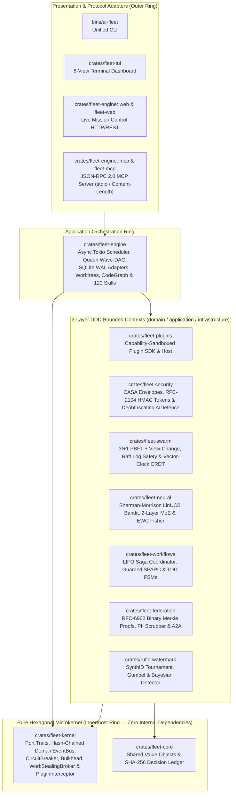
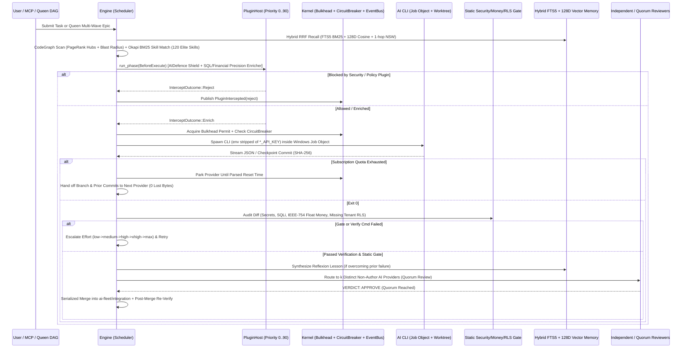

# 🏛 AI-Fleet v7.0 — Hexagonal DDD & Microkernel Architecture Reference

AI-Fleet v7.0 is engineered as a **20-Crate Native Rust Monorepo** governed by **Hexagonal Ports-and-Adapters (`SOLID` Dependency Inversion)**, **Bounded-Context 3-Layer Domain-Driven Design (`domain / application / infrastructure`)**, an **Async Event-Sourced Microkernel**, and **Compile/Test-Time Architectural Fitness Functions** (`bins/ai-fleet/tests/architecture_tests.rs`).

---

## 1. Layered Workspace Topology (C4 Container & Dependency Flow)

All dependencies point **strictly inward** toward `fleet-kernel` and `fleet-core`. Automated tests verify zero crate cycles and forbid inner layers from importing outer adapters.

---

## 2. Hexagonal Ports & Microkernel Execution Sequence

Every task dispatched through `fleet-engine` traverses capability-sandboxed `PluginInterceptor` hooks, `Bulkhead` concurrency permits, `CircuitBreaker` state machines, isolated Git worktrees, deterministic static gates, and independent/quorum non-author review:

---

## 3. Core Mathematical & Distributed-Systems Foundations

| Subsystem | Crate & Module | Algorithm / Guarantee |
| :--- | :--- | :--- |
| **Microkernel & Resilience** | `fleet-kernel::{resilience, claims, events}` | 3-state `CircuitBreaker` (`Closed/Open/HalfOpen`), `Semaphore` `Bulkhead`, SplitMix64 full-jitter backoff, FIFO-steal `WorkStealingBroker`, SHA-256 `DomainEventBus` |
| **Contextual Bandit Routing** | `fleet-neural::application::LinUcbRouter` | Disjoint LinUCB ($\hat{\theta}_a^\top x + \alpha\sqrt{x^\top A_a^{-1}x}$) with exact $O(d^2)$ Sherman-Morrison rank-1 inverse updates |
| **Byzantine & Crash Consensus** | `fleet-swarm::application` | $3f+1$ PBFT with equivocation detection & deterministic view-change; Raft §5.4.1 up-to-date log election & §5.4.2 majority commit; Causal Vector-Clock LWW CRDT |
| **Transactional Workflows** | `fleet-workflows::application` | LIFO Saga Compensation state machine, Guarded 5-stage SPARC FSM, strict Red-Green-Refactor TDD FSM |
| **Cryptographic Federation** | `fleet-federation::application` | RFC-6962 domain-separated (`0x00`/`0x01`) SHA-256 Binary Merkle Tree inclusion proofs + SynthID Gumbel/Tournament watermarking |
| **Hybrid Memory & Skills** | `fleet-engine::{memory, skills, intelligence}` | SQLite FTS5 + 128-D CountSketch cosine vectors + 1-hop NSW graph via RRF; Okapi BM25 over 120 embedded GitHub skills; iterative PageRank ($d=0.85$) + Tarjan SCC |
